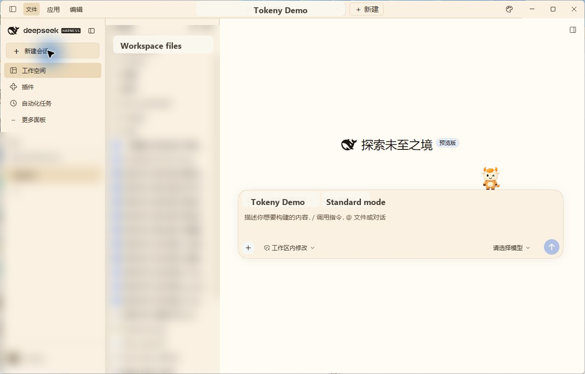
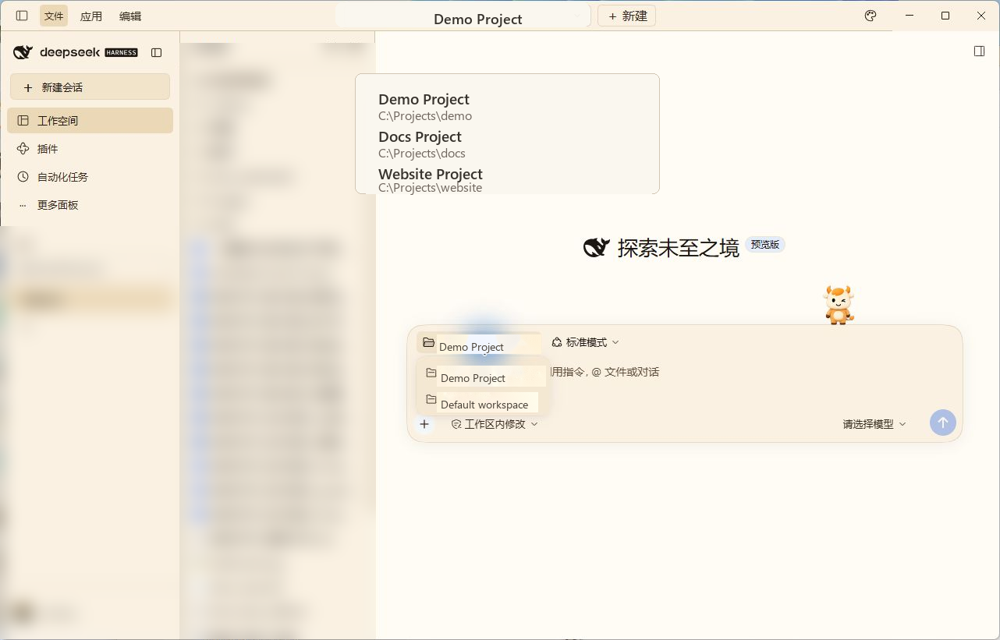
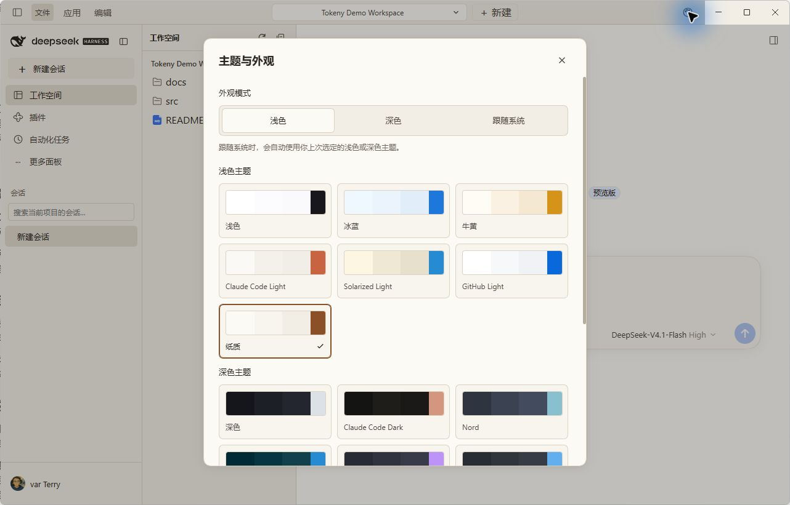
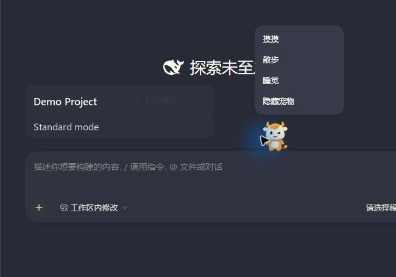

# tokenyUI

English | [中文](README.zh.md)

Tokeny-style workspace UI for DeepSeek Harness desktop. The plugin keeps the native DeepSeek logo and window controls, then adds project switching, a workspace file tree, project-scoped sessions, Tokeny themes, and an input companion.

> **Community plugin:** tokenyUI is published by Tokeny AI and is not an official DeepSeek plugin. It does not change the DeepSeek logo or send model requests of its own.

<p align="center">
  
</p>

## What it adds

<table>
  <thead>
    <tr><th align="left">Area</th><th align="left">Behavior</th></tr>
  </thead>
  <tbody>
    <tr><td>Project bar</td><td>Switch or add projects from the native title bar.</td></tr>
    <tr><td>Workspace</td><td>Browse the active project's files and open native previews.</td></tr>
    <tr><td>Sessions</td><td>The Workspace tab shows only sessions belonging to the selected project.</td></tr>
    <tr><td>Appearance</td><td>Choose Tokeny palettes plus Light, Dark, or System mode.</td></tr>
    <tr><td>Input companion</td><td>Choose one of seven local sprite pets and control sleep, walking, and visibility.</td></tr>
  </tbody>
</table>

## Screenshots

<table>
  <tr>
    <td align="center" width="50%">
      
      <br /><sub>Project switcher</sub>
    </td>
    <td align="center" width="50%">
      
      <br /><sub>Themes and appearance</sub>
    </td>
  </tr>
  <tr>
    <td align="center" colspan="2">
      
      <br /><sub>Input companion menu</sub>
    </td>
  </tr>
</table>

## Install the desktop release

Use the matching DeepSeek Harness desktop `0.2.2-rc.1` runtime. The CLI bundled with the desktop app installs the GitHub Release asset:

```powershell
dsh plugin --profile desktop add https://github.com/tokeny-ai/tokenyUI/releases/download/v0.2.2-rc.1-tokeny.7/tokeny-ai-dsh-client-tokeny-ui-0.2.2-rc.1-tokeny.7.tgz
```

Restart Harness after installation. The [v0.2.2-rc.1-tokeny.7 release](https://github.com/tokeny-ai/tokenyUI/releases/tag/v0.2.2-rc.1-tokeny.7) contains the tarball and a SHA-256 checksum asset. To remove the layout bundle, run `dsh plugin --profile desktop remove @tokeny-ai/dsh-client-tokeny-ui` and restart Harness.

Use the release `.tgz` URL above for installation. A repository URL such as `https://github.com/tokeny-ai/tokenyUI` is a Git source; pnpm may translate it to `git+ssh://git@github.com/...` and fail when the user has no GitHub SSH key.

## Source and compatibility

The source package is under [`packages/client/tokeny-ui`](packages/client/tokeny-ui). The desktop adapter targets DeepSeek Harness desktop `0.2.2-rc.1`; the legacy Web adapter targets the separate `0.1.0-rc.5` client APIs. Read the [desktop guide](packages/client/tokeny-ui/src/desktop/README.md) for behavior, limitations, and verification details.

The package is MIT licensed. See [`plugin-catalog.json`](plugin-catalog.json) for machine-readable distribution metadata and [`docs/community/announcement.md`](docs/community/announcement.md) for a shareable announcement.
