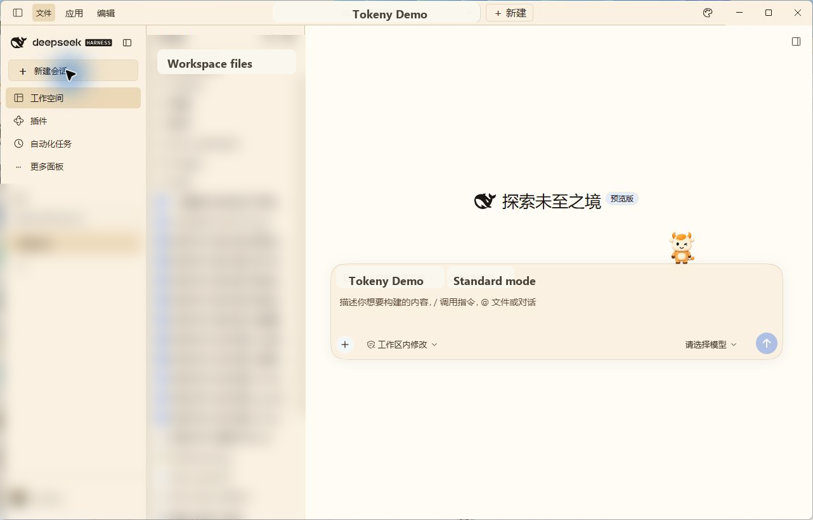
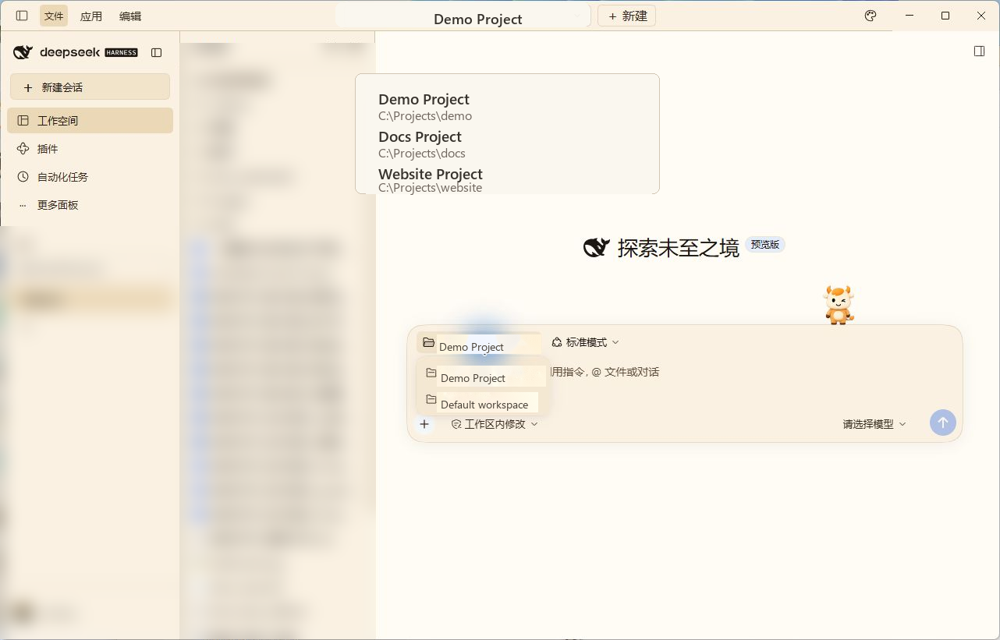
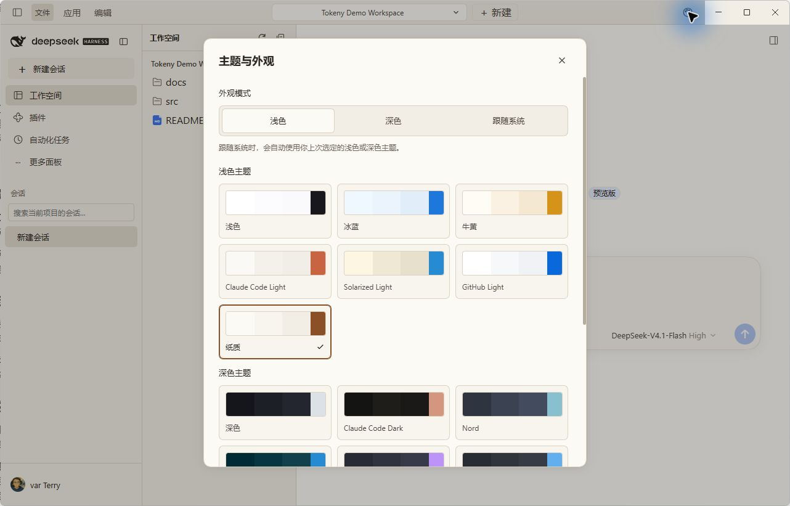
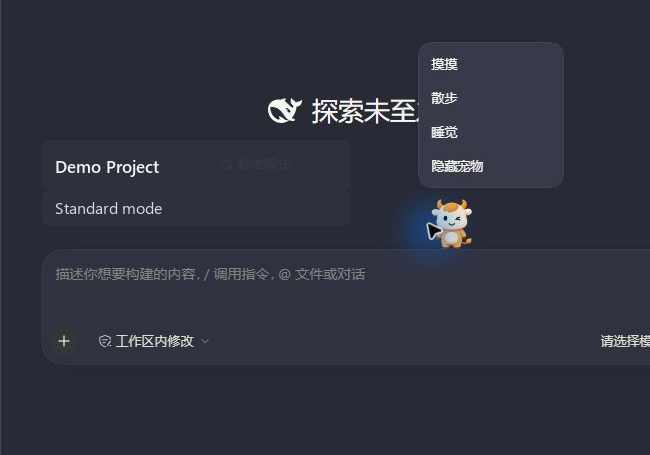

# tokenyUI

[English](README.md) | 中文

Tokeny 风格的 DeepSeek Harness 桌面工作区插件。它保留原生 DeepSeek logo 和窗口控件，并加入项目切换、工作区文件树、按项目隔离的会话列表、Tokeny 主题和输入框宠物。

> **社区插件：** tokenyUI 由 Tokeny AI 发布，不是 DeepSeek 官方插件。它不会修改 DeepSeek logo，也不会自行发送模型请求。

<p align="center">
  
</p>

## 功能

<table>
  <thead>
    <tr><th align="left">区域</th><th align="left">行为</th></tr>
  </thead>
  <tbody>
    <tr><td>项目栏</td><td>在原生标题栏中切换或添加项目。</td></tr>
    <tr><td>工作区</td><td>浏览当前项目文件，并打开原生预览。</td></tr>
    <tr><td>会话</td><td>“工作空间”标签只显示当前项目所属的会话。</td></tr>
    <tr><td>外观</td><td>选择 Tokeny 配色以及浅色、深色或跟随系统模式。</td></tr>
    <tr><td>输入框宠物</td><td>选择七种本地精灵宠物，并控制散步、睡眠和显示状态。</td></tr>
  </tbody>
</table>

## 截图

<table>
  <tr>
    <td align="center" width="50%">
      
      <br /><sub>项目切换器</sub>
    </td>
    <td align="center" width="50%">
      
      <br /><sub>主题与外观</sub>
    </td>
  </tr>
  <tr>
    <td align="center" colspan="2">
      
      <br /><sub>输入框宠物菜单</sub>
    </td>
  </tr>
</table>

## 安装桌面版 Release

请使用匹配的 DeepSeek Harness 桌面版 `0.2.2-rc.1`。使用桌面应用自带的 CLI 安装 GitHub Release 资产：

```powershell
dsh plugin --profile desktop add https://github.com/tokeny-ai/tokenyUI/releases/download/v0.2.2-rc.1-tokeny.7/tokeny-ai-dsh-client-tokeny-ui-0.2.2-rc.1-tokeny.7.tgz
```

安装后重启 Harness。[v0.2.2-rc.1-tokeny.7 Release](https://github.com/tokeny-ai/tokenyUI/releases/tag/v0.2.2-rc.1-tokeny.7) 提供压缩包和 SHA-256 校验文件。如需移除布局组合包，执行 `dsh plugin --profile desktop remove @tokeny-ai/dsh-client-tokeny-ui` 后重启 Harness。

请使用上面的 Release `.tgz` 地址。直接使用 `https://github.com/tokeny-ai/tokenyUI` 这样的仓库地址时，pnpm 可能将其解析为 `git+ssh://git@github.com/...`，在没有 GitHub SSH Key 时会安装失败。

## 源码与兼容性

源码位于 [`packages/client/tokeny-ui`](packages/client/tokeny-ui)。桌面适配器面向 DeepSeek Harness 桌面版 `0.2.2-rc.1`；旧版 Web 适配器面向独立的 `0.1.0-rc.5` 客户端 API。行为、限制和验证说明见[桌面版指南](packages/client/tokeny-ui/src/desktop/README.md)。

此包使用 MIT 许可证。机器可读的分发元数据见 [`plugin-catalog.json`](plugin-catalog.json)，可直接分享的社区文案见 [`docs/community/announcement.zh.md`](docs/community/announcement.zh.md)。
