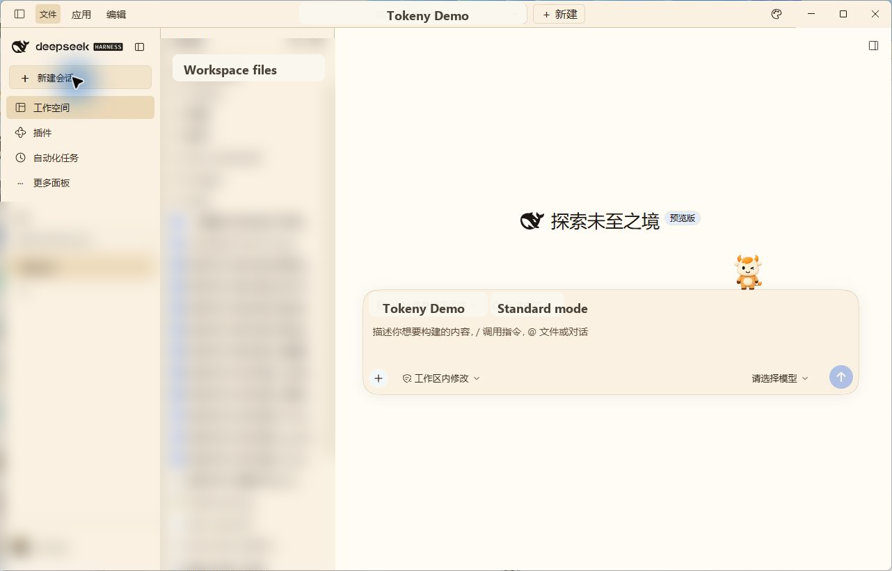
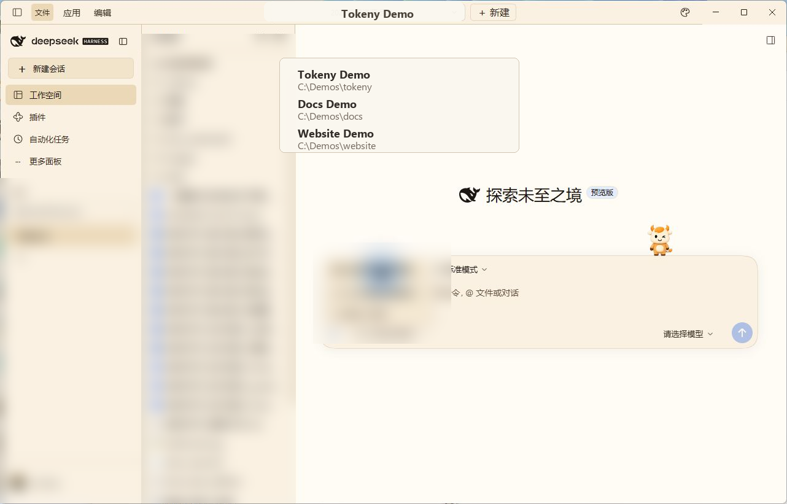
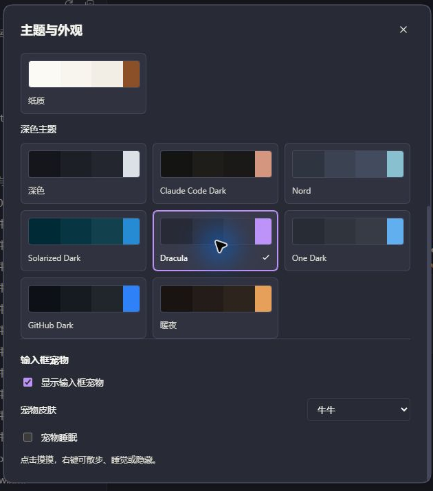
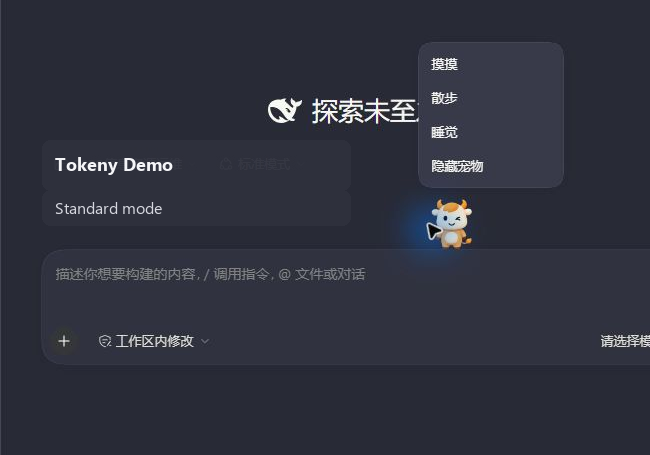

# tokenyUI

[English](README.md) | 中文

## Summary

`tokenyUI` 为 Harness 提供 Tokeny 风格的工作空间：居中的项目切换器、窄活动侧栏，以及可调整宽度的左侧文件与会话面板。可以按名称或路径搜索项目、预览文本文件，并查找、重命名或归档当前项目的会话。Harness 现有的对话、工具详情、设置和插件面板继续通过各自插槽提供。此包同时包含 Web 配置档适配器和桌面版组合包适配器。此插件由 Tokeny AI 社区发布，不是 DeepSeek 官方插件。

## 截图









## Table of Contents

- [使用此包](#use-this-package)
- [了解实现](#understand-the-implementation)
- [模型体验](#model-experience)
- [已知限制与延后工作](#known-limitations-and-deferred-work)
- [开发备注](#dev-note)

-----

<a id="use-this-package"></a>
## 使用此包

配合匹配的 Harness `0.1.0-rc.5` 安装使用提供的压缩包。在压缩包所在目录执行以下命令，将其安装到配置档：

```sh
dsh plugin --profile web add ./tokeny-ai-dsh-client-tokeny-ui-0.2.2-rc.1-tokeny.7.tgz
```

安装后重启 Harness Web。插件包的配置层替换默认布局和侧栏，无需修改核心会话插件。首次安装可能下载 npm 依赖。选择**添加项目**，输入 Harness 主机上文件夹的绝对路径并打开项目。文件树展示真实目录，选择 UTF-8 文本文件即可打开只读预览。

左侧面板初始宽度为 360 px，可在 340 至 720 px 之间调整。选中的标签页、折叠状态、宽度和已展开目录保存在当前浏览器中。项目选择与会话操作使用 Harness 的工作区和会话服务。**管理所有项目与会话**打开原有 Harness 工作区控件。外观和语言遵循 Harness 设置。

如需恢复默认外壳，移除插件包并重启 Harness Web：

```sh
dsh plugin --profile web remove @tokeny-ai/dsh-client-tokeny-ui
```

仅禁用运行时插件仍会让配置档中的默认外壳配置行保持禁用；需移除组合包才能恢复这些配置行。

-----

<a id="understand-the-implementation"></a>
## 了解实现

<details>
<summary>实现细节 — 点击展开</summary>

[配置档补丁](cordis.patch.yml)禁用 `ui-layout` 和 `ui-sidebar`，并插入 `tokenyUI`。[浏览器组装入口](src/client/index.ts)负责根布局与侧栏插槽，同时组合现有的会话、详情、设置和浮层贡献。共享插槽 store 保存浏览偏好，业务状态仍由 Harness 运行时管理。所有外壳代码、配色覆盖、中英文文案和文件系统 RPC 均包含在此包中。

[Host 入口](src/index.ts)注册 trusted-host Connection 通道，接收已注册工作区 ID 和相对路径。它拒绝路径穿越与符号链接，限制目录响应，并按文本渲染预览内容。`maxEntries` 默认每个目录 2,000 项，可配置范围为 1–20,000。`maxPreviewBytes` 默认 262,144 字节，范围为 1,024–4,194,304。在 `tokenyUI` 配置行设置这些字段。已挂载视图会取消过期请求。插件卸载时通过效果清理撤销注册和主题投影。

组合和所有权约束见[外壳决策](../../../.agents/notes/implemented/feature/2026-11-07-tokeny-ui-shell.md)。

</details>

-----

<a id="model-experience"></a>
## Model Experience

None，外壳和文件预览不添加提示词、工具或模型请求内容。

#### KV Cache effect

None；此包既不组装也不发送提供商请求。

## Known Limitations and Deferred Work

<a id="known-limitations-and-deferred-work"></a>

- 文件浏览面向 Harness 主机的本地文件系统。原生目录选择取决于主机的目录选择提供者；无法打开原生对话框时仍可使用绝对路径表单。
- 预览仅支持只读 UTF-8 文本。编辑、二进制预览和远程沙箱文件系统浏览不在此包的范围内。目录条目有数量上限，文件变化后需**刷新文件**。
- 外壳保留 Harness 的对话渲染器和欢迎内容。Tokeny 的原生窗口控件、嵌入式应用及编辑器功能没有移植。
- 面板偏好属于当前浏览器来源。更换浏览器或服务端口后，面板使用初始偏好。

<a id="dev-note"></a>
### Dev Note

无。
