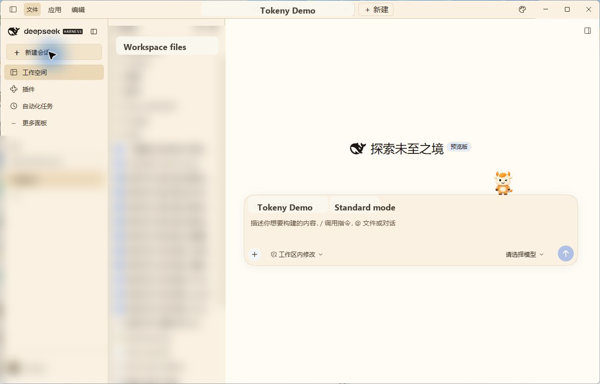
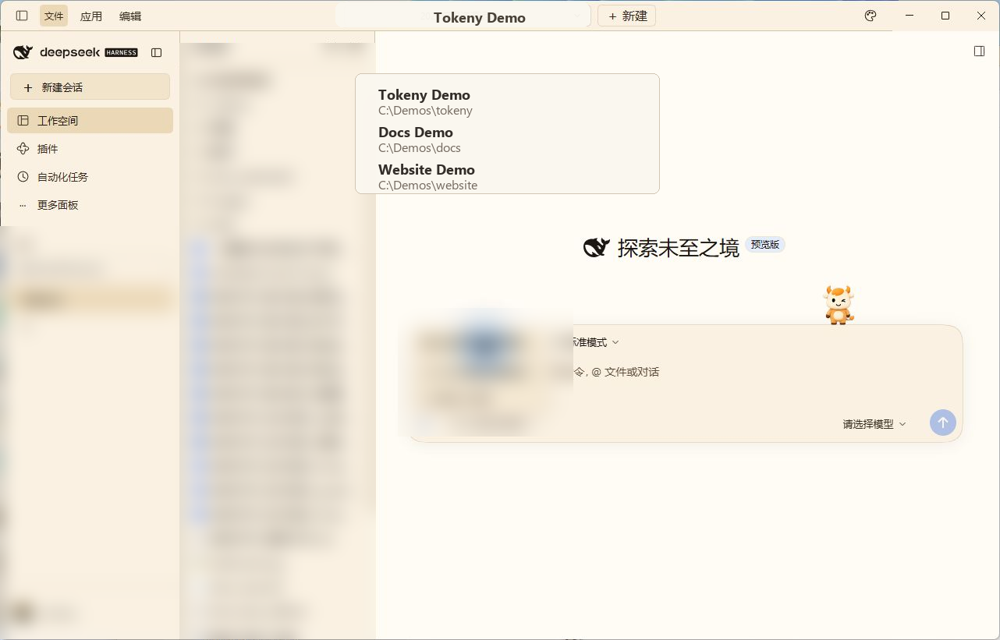
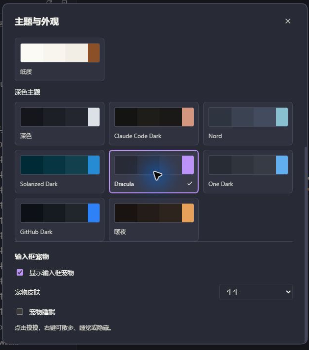
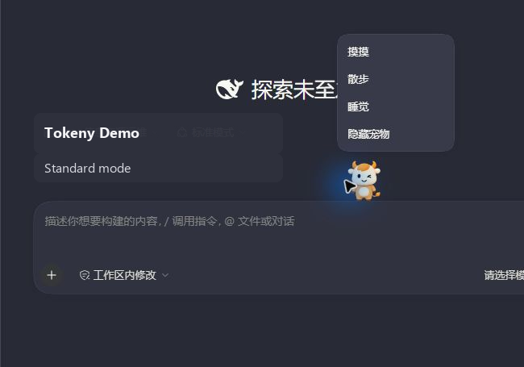

# tokenyUI for desktop

English | [中文](README.zh.md)

## Summary

`tokenyUI` gives DeepSeek Harness desktop `0.2.2-rc.1` a top project switcher, a left navigation sidebar, and a resizable workspace file tree. It includes 15 Tokeny themes and seven input companions. The sidebar retains the official DeepSeek whale logo and wordmark. Existing conversations, plugin panels, settings, and file previews use their native Harness services and renderers. This is a community plugin published by Tokeny AI; it is not an official DeepSeek plugin.

## Screenshots









## Table of Contents

- [Use this package](#use-this-package)
- [Understand the implementation](#understand-the-implementation)
- [Model Experience](#model-experience)
- [Known Limitations and Deferred Work](#known-limitations-and-deferred-work)
- [Dev Note](#dev-note)

-----

<a id="use-this-package"></a>
## Use this package

Install the desktop tarball with the CLI bundled in the matching desktop release. From the folder containing the tarball, run this PowerShell command:

```powershell
& "$env:LOCALAPPDATA\Programs\DeepSeek Harness\resources\runtime\cli\bin\dsh.cmd" plugin --profile desktop add .\tokeny-ai-dsh-client-tokeny-ui-0.2.2-rc.1-tokeny.7.tgz
```

Restart DeepSeek Harness after installation. Select or add a project from the top bar; the left file tree follows the selected session's working directory. File selection opens the existing Harness preview panel. The sidebar's Workspace tab lists and searches only the selected project's sessions, with native session menus, rename, pin, and archive actions. Other sidebar panels hide this list. The sidebar retains the account menu and plugin navigation.

The latest desktop tarball is available from the [tokenyUI GitHub Releases](https://github.com/tokeny-ai/tokenyUI/releases). The release asset is compatible with the matching Harness desktop `0.2.2-rc.1` runtime. Keep the original DeepSeek logo and native window controls when evaluating the layout; the plugin does not replace application branding.

The new-conversation project folder and mode controls appear inside the input card, above the text area. Their native menus and behavior remain available, and the input companion stays above the card.

On Windows, project and appearance controls share the native 40px titlebar with the Application and Edit menus. The installed application provides its original minimize, maximize, and close buttons. The file header offers refresh and collapse controls; drag the column separators to resize the sidebar, file tree, and open preview panel.

Open Themes and appearance from the top bar to choose a Tokeny palette or Light, Dark, or System mode. System mode uses the last selected light or dark palette. Harness owns the mode preference; this plugin saves the two palette choices in browser storage. Language and font preferences follow Harness settings.

The appearance panel also controls the input companion's visibility, skin, and sleep state. Seven original Tokeny sprite skins are available, with the orange cat enabled by default. Click the companion to pet or wake it; its context menu offers walking, sleep, and hiding. Animation follows conversation activity and pauses when the window is inactive, the page is hidden, or reduced motion is enabled. Typing pauses automatic walking.

Remove the `@tokeny-ai/dsh-client-tokeny-ui` bundle and restart Harness to restore the default layout; disabling only its plugin row leaves the bundle's layout overrides active.

-----

<a id="understand-the-implementation"></a>
## Understand the implementation

<details>
<summary>Implementation internals — click to expand</summary>

The profile patch disables `ui-layout` and `ui-sidebar` and inserts `tokenyUI`. The [browser entry](index.ts) provides the layout service and root slots, preserving official brand, main-panel, right-panel, bottom, and overlay composition. The [sidebar](Sidebar.tsx) derives the selected project's sessions from the native current-session pointer and workspace membership. A pending project switch uses the requested workspace and rejects superseded navigation. The Workspace tab retains native row-action providers and context menus without mounting the global workspace catalog.

The [root layout](Root.tsx) exposes the native shell-overlay marker so the desktop preload can mount its menus. It measures the native menu, reserves caption-button space, and uses drag regions around its interactive controls. The plugin does not modify the application archive, preload, or native window implementation.

The [file navigator](FileExplorer.tsx) reads directories through the native `remote.workspaceFiles` API, renders the official file-tree factory, and opens resources through the existing right sidebar. This desktop package adds no host file-system RPC. Its host entry is presentation-only. Plugin effects own registrations and restore the theme projection when unloaded.

The [composer adapter](ComposerLayout.ts) measures the native new-conversation project and preset row and reserves room inside the input card. CSS positions the row in that area while Harness retains its React ownership and callbacks. The adapter restores styles when the row disappears or the plugin unloads.

The [theme controller](theme.ts) maps the original Tokeny semantic colors through Harness's native token overrides and retains native theme-source and font hints. Palette choices use `tokenyUI.theme.v1` in local storage. The [companion registration](pets/register.ts) contributes to the native `conversation.input.dock` list and adds its settings through `tokenyUI.themes.extra`, preserving the original composer. Companion choices use `dsh.tokenyUI.pet`. Sprite sheets and frame timings come from Tokeny's built-in assets; all seven skins ship locally.

</details>

-----

<a id="model-experience"></a>
## Model Experience

None. This package adds no model prompts, tools, or provider requests.

#### KV Cache effect

None; this package does not assemble or send model requests.

## Known Limitations and Deferred Work

<a id="known-limitations-and-deferred-work"></a>

- This artifact targets Harness desktop `0.2.2-rc.1`; the legacy `0.1.0-rc.5` web artifact uses different client APIs.
- The file tree needs an active session with a working directory. Directory access and previews follow the native Harness service's permissions and supported formats.
- Directory contents refresh on request. Column geometry and expanded folders reset when the plugin reloads.
- Palette and companion preferences belong to the current browser origin. If browser storage refuses a write, the current selection remains active and the appearance panel offers a save retry.
- The sidebar omits archived and subagent sessions; an empty session appears only while it is open. Other Tokeny application features are outside this package's scope.

<a id="dev-note"></a>
### Dev Note

The [browser smoke](../../scripts/smoke-desktop.mjs) targets an already started isolated Harness web host with this package installed. Set `TOKENY_UI_SMOKE_HOST_LOG` to that host's log, then run `node packages/client/tokeny-ui/scripts/smoke-desktop.mjs` from the repository root. The test creates unique fixture projects and sessions and writes screenshots under `.artifacts/tokenyUI`. It covers project filtering, native session actions, file previews, palette and companion preferences across reload, and narrow layouts. It simulates the Windows preload markers and menu for titlebar geometry checks; it does not operate the native desktop window. The script resolves Playwright from `apps/web`; set `TOKENY_UI_CHROME` when Chrome is outside its usual installation paths. Use a test profile with account onboarding disabled and an English locale.
