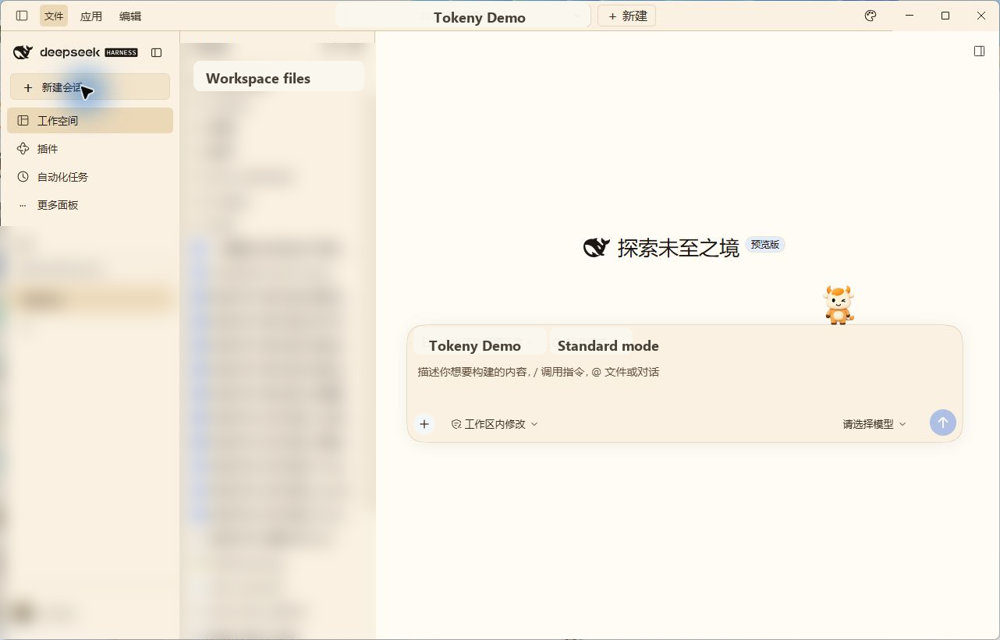
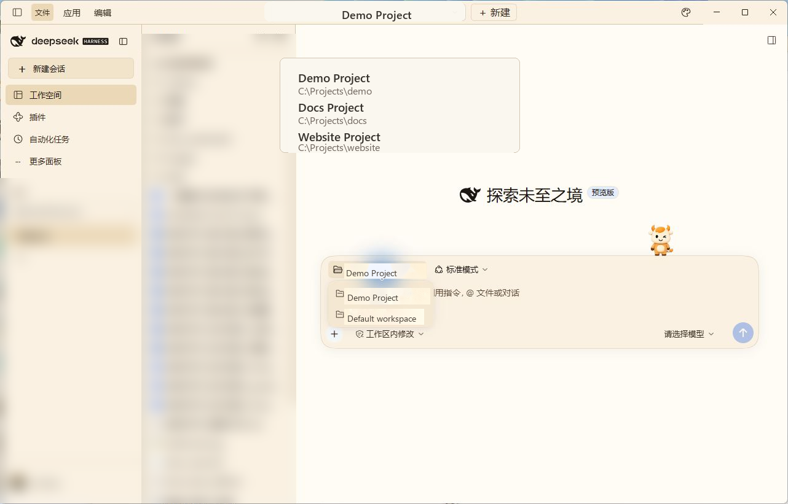
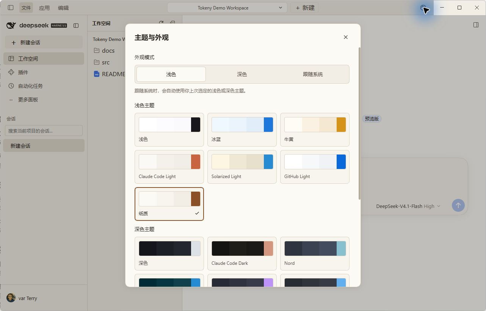
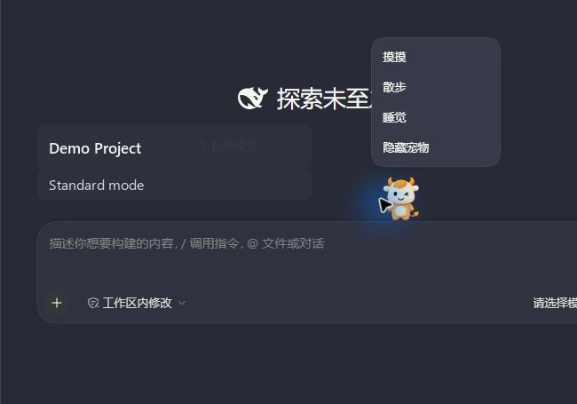

# tokenyUI 桌面版

[English](README.md) | 中文

## Summary

`tokenyUI` 为 DeepSeek Harness 桌面版 `0.2.2-rc.1` 加入顶部项目切换器、左侧导航栏，以及可调整宽度的工作区文件树，并提供 15 套 Tokeny 主题和七种输入框宠物。侧栏保留官方 DeepSeek 鲸鱼 logo 和字标。现有对话、插件面板、设置和文件预览使用 Harness 原生服务与渲染器。此插件由 Tokeny AI 社区发布，不是 DeepSeek 官方插件。

## 截图

<p align="center">
  
</p>

<table>
  <tr>
    <td align="center" width="50%">
      
      <br /><sub>项目切换器</sub>
    </td>
    <td align="center" width="50%">
      
      <br /><sub>主题与外观</sub>
    </td>
  </tr>
  <tr>
    <td align="center" colspan="2">
      
      <br /><sub>输入框宠物菜单</sub>
    </td>
  </tr>
</table>

## Table of Contents

- [使用此包](#use-this-package)
- [了解实现](#understand-the-implementation)
- [模型体验](#model-experience)
- [已知限制与延后工作](#known-limitations-and-deferred-work)
- [开发备注](#dev-note)

-----

<a id="use-this-package"></a>
## 使用此包

使用匹配桌面版本自带的 CLI 安装桌面版压缩包。在压缩包所在文件夹中运行以下 PowerShell 命令：

```powershell
& "$env:LOCALAPPDATA\Programs\DeepSeek Harness\resources\runtime\cli\bin\dsh.cmd" plugin --profile desktop add .\tokeny-ai-dsh-client-tokeny-ui-0.2.2-rc.1-tokeny.7.tgz
```

安装后重启 DeepSeek Harness。在顶部选择或添加项目，左侧文件树随所选会话的工作目录变化。选择文件会打开原有 Harness 预览面板。侧栏“工作空间”标签只列出并搜索所选项目的会话，提供原生会话菜单、重命名、置顶和归档操作；切换到其他侧栏面板时隐藏此列表。侧栏保留账号菜单及插件导航。

最新桌面压缩包发布在 [tokenyUI GitHub Releases](https://github.com/tokeny-ai/tokenyUI/releases)。发布资产与匹配的 Harness 桌面版 `0.2.2-rc.1` 运行时兼容。评估布局时会保留原 DeepSeek logo 和原生窗口控件；插件不会替换应用品牌。

新会话的项目文件夹和模式控件显示在输入卡片内部、文本区上方，保留原生菜单和行为。输入框宠物位于卡片上方。

在 Windows 上，项目和外观控件与“应用”“编辑”菜单共用原生 40px 标题栏。安装的应用提供原有最小化、最大化和关闭按钮。文件区顶部提供刷新和折叠控件；拖动列之间的分隔线，可调整侧栏、文件树和已打开预览面板的宽度。

从顶部打开“主题与外观”，可选择 Tokeny 配色以及浅色、深色或跟随系统模式。跟随系统模式使用上次选定的浅色或深色配色。模式偏好由 Harness 管理；插件将两种配色选择保存在浏览器存储中。语言和字体偏好遵循 Harness 设置。

外观面板还可设置输入框宠物的显示、皮肤与睡眠状态。七种原版 Tokeny 精灵皮肤可供选择，默认启用小橘。点击宠物可摸摸或叫醒；右键菜单提供散步、睡觉和隐藏操作。动画随会话活动变化，在窗口失去焦点、页面隐藏或启用减少动态效果时暂停。输入时暂停自动散步。

移除 `@tokeny-ai/dsh-client-tokeny-ui` 组合包并重启 Harness 可恢复默认布局；仅禁用其插件行仍会保留组合包的布局覆盖。

-----

<a id="understand-the-implementation"></a>
## 了解实现

<details>
<summary>实现细节 — 点击展开</summary>

配置档补丁禁用 `ui-layout` 和 `ui-sidebar`，并插入 `tokenyUI`。[浏览器入口](index.ts)提供布局服务与根插槽，保留官方品牌、主面板、右面板、底部和浮层组合。[侧栏](Sidebar.tsx)从原生当前会话指针和工作区归属推导所选项目的会话。项目切换期间使用请求目标的工作区，并拒绝过期导航。“工作空间”标签保留原生行操作提供者和上下文菜单，不挂载全局项目目录。

[根布局](Root.tsx)提供原生浮层标记，让桌面预加载脚本可以挂载菜单。它测量原生菜单、为窗口按钮预留空间，并在交互控件周围设置拖动区域。插件不修改应用归档、预加载脚本或原生窗口实现。

[文件导航器](FileExplorer.tsx)通过原生 `remote.workspaceFiles` API 读取目录，使用官方文件树工厂渲染，并通过现有右侧栏打开资源。此桌面包不增加主机文件系统 RPC。其 Host 入口仅承载界面插件。插件效果管理各项注册，并在卸载时恢复主题投影。

[输入框适配器](ComposerLayout.ts)测量原生新会话项目和预设行，并在输入卡片内预留空间。CSS 将该行定位到此区域，Harness 保留其 React 所有权和回调。该行消失或插件卸载时，适配器恢复样式。

[主题控制器](theme.ts)通过 Harness 原生 token 覆盖映射原版 Tokeny 语义颜色，并保留原生主题来源和字体标记。配色选择使用本地存储中的 `tokenyUI.theme.v1`。[宠物注册](pets/register.ts)向原生 `conversation.input.dock` 列表添加组件，并通过 `tokenyUI.themes.extra` 添加设置，保留原有输入框。宠物选择使用 `dsh.tokenyUI.pet`。精灵图集与帧时序来自 Tokeny 内置素材；七种皮肤均随包本地提供。

</details>

-----

<a id="model-experience"></a>
## Model Experience

None，此包不添加模型提示词、工具或提供商请求。

#### KV Cache effect

None；此包不组装或发送模型请求。

## Known Limitations and Deferred Work

<a id="known-limitations-and-deferred-work"></a>

- 此构建产物面向 Harness 桌面版 `0.2.2-rc.1`；旧版 `0.1.0-rc.5` Web 产物使用不同的客户端 API。
- 文件树需要具有工作目录的活动会话。目录访问与预览遵循 Harness 原生服务的权限和格式支持。
- 目录内容按需刷新。插件重新加载后，列宽和已展开目录恢复初始状态。
- 配色和宠物偏好属于当前浏览器源。浏览器存储拒绝写入时，当前选择继续生效，外观面板提供重试保存操作。
- 侧栏不显示已归档会话和子代理会话；空会话仅在打开时显示。Tokeny 的其他应用功能不在此包范围内。

<a id="dev-note"></a>
### Dev Note

[浏览器烟测](../../scripts/smoke-desktop.mjs)连接已安装此包并启动的隔离 Harness Web 主机。将 `TOKENY_UI_SMOKE_HOST_LOG` 设置为该主机日志路径，然后从仓库根目录运行 `node packages/client/tokeny-ui/scripts/smoke-desktop.mjs`。测试创建路径唯一的示例项目和会话，并将截图保存到 `.artifacts/tokenyUI`。它覆盖项目过滤、原生会话操作、文件预览、重载后的配色与宠物偏好，以及窄屏布局。脚本模拟 Windows 预加载标记和菜单来检查标题栏几何布局；它不操作原生桌面窗口。脚本从 `apps/web` 解析 Playwright；Chrome 不在常见安装路径时可设置 `TOKENY_UI_CHROME`。使用禁用账号引导且语言为英语的测试配置档。
